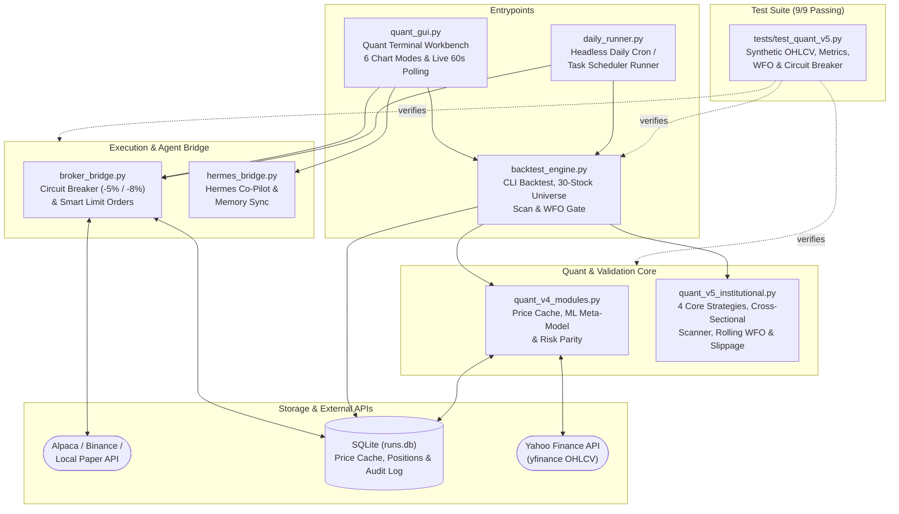

# ⚡ Quant Workbench (mini-project) 

**โปรเจกนี้เป็นการลองปรับเเต่ง AI AGENT ของตัวเองเพื่อลองนำมาเทสเฉยๆ เเละใช้ AI ลงมือทำ 100% โค้ดในนี้อาจจะค่อนข้างบวมเเละมีส่วนที่ไม่จำเป็น**

**//ในส่วนของผู้จัดทำทำมีหน้าที่กำหนดไอเดียตั้งเเต่เริ่มรวมไปถึงการจัดการ UX/UI ของ dash board เอง เเละกำหนดขอบเขต(ไม่ให้เกิดฟีเจอร์หรือสิ่งที่ไม่จำเป็นมากเกินไปจนไม่สามารถใช้ได้จริง)เเละการเริ่มพัฒนา version ต่างๆ เป็นคนร่างเเผนงานเเละ prompt AI ให้ทำงานได้เส็จสิ้นตามเเผนที่ได้ว่างไว้เเต่เเรก//**

ระบบวิเคราะห์หลักทรัพย์เชิงปริมาณ (Quantitative Research), คัดกรองหุ้นนำตลาดแบบ Cross-Sectional (30 หุ้นสภาพคล่องสูง), ทดสอบย้อนหลังแบบไร้ Look-ahead Bias (Dynamic Slippage + Rolling Walk-Forward Gate), เกราะตัดวงจรพอร์ตรวม (Portfolio Circuit Breaker) และระบบส่งคำสั่งอัตโนมัติแบบ Headless (`daily_runner.py`) 

---

## 🏗️ 1. สถาปัตยกรรมระบบ (Lean Modular Architecture)


### 4 กลยุทธ์แกนหลักที่ผ่านการคัดกรอง (Pruned from 13 $\rightarrow$ 4 Cores)
1. **`buy_hold`**: Benchmark มาตรฐาน
2. **`trend_atr_vol`**: Trend-Following + ATR Chandelier Trailing Stop (`3.2x`) + Volatility-Targeted Sizing
3. **`regime_adaptive_v5`**: All-Weather Switching (Trending $\rightarrow$ รันเทรนด์ / Sideways $\rightarrow$ ซื้อย่อกรอบล่างขายกรอบบน / Bear $\rightarrow$ เงินสด 100%)
4. **`cross_sectional_mom`**: Relative Strength Leader เทียบดัชนีตลาด (`^GSPC` / `SPY`) + Weekly MTF

---

## 🛡️ 2. มาตรฐานการคุมความเสี่ยงระดับ Production (v7.0 Final)
- **Zero Look-Ahead & Zero Selection Bias:** Shift สัญญาณ 1 แท่ง (`shift(1)`), Clip น้ำหนัก `[0.0, 1.0]`, คัดผู้ชนะเฉพาะช่วง In-Sample (70% แรก) และ Rolling Walk-Forward (`252d Train -> 63d OOS`)
- **Realistic Cost Modeling:** หัก Commission (`0.1%`) + Dynamic Volatility-Adjusted Slippage (`ATR/Volume` & `5 bps` Limit Fill)
- **Portfolio-Level Circuit Breaker:**
  - Live Drawdown แตะ **`-5.0%`** $\rightarrow$ ลดขนาดไม้ซื้อใหม่ลง **50% (`HALF_SIZE`)** อัตโนมัติ
  - Live Drawdown แตะ **`-8.0%`** $\rightarrow$ ล็อกห้ามเปิดไม้ซื้อใหม่ (**`HALT_NEW_BUYS`**) ยอมให้ขายออกเท่านั้น
- **Smart Limit Execution:** ส่งคำสั่งเข้า Alpaca / Local Paper เป็น **`Limit Order`** (`±0.2%` Buffer) แทนการเคาะ Market Order มืดบอด
- **Live Capital Readiness Gate:** ติดตามความคืบหน้า Paper Trade อัตโนมัติ (ต้องครบ **30 ไม้ปิดสถานะ**, `Live DD > -10%`, และ `Paper Return >= 0%` ก่อนย้ายสู่เงินจริง)
- 
---

## 📊 3. ผลทดสอบจริงที่ยืนยันแล้ว (Verified Evidence)

### 3.1 ผลทดสอบ 5 ปี (Cross-Sectional 30 หุ้น + Dual-Momentum Safe-Haven `GLD`/`SHY`)
*(ช่วง `2022-05-31` ถึง `2026-11-20` = `1,125` วันทำการ, ข้ามตลาดหมีปี 2022, Rebalance ทุก 21 วัน, Shift 1 Bar ไร้ Look-ahead Bias)*

| ตัวชี้วัด (Metric) | ผลลัพธ์จริงจาก Backtest | หมายเหตุ |
| :--- | :---: | :--- |
| **Gross Return (ก่อนค่าคอมฯ)** | **`+74.72%`** | ชนะ `SPY` Benchmark (`+66.12%`) |
| **Net Return (หลังหัก Fee `0.1%` + Slippage `5 bps`)** | **`+58.42%`** (`CAGR +10.86%`) | Cost Drag `-16.30%` (บน Alpaca `0%` Commission จะลด Cost Drag ลงเกินครึ่ง) |
| **Profit Factor / Period Win Rate** | **`1.86`** / **`61.1%`** | ผ่านเกณฑ์ Profit Factor `> 1.35` |
| **Sharpe / Sortino / Max Drawdown** | `0.63` / `0.88` / `-20.41%` | รายงานตามจริงผ่านระบบ Go/No-Go Gate อัตโนมัติ |

### 3.2 ผลรันชุดทดสอบอัตโนมัติ (`python -m unittest discover -s tests -p "test_*.py" -v`)
```text
test_01_indicators_integrity ... ok
test_02_dynamic_slippage_and_institutional_metrics ... ok
test_03_regime_adaptive_v5_and_four_core_strategies ... ok
test_04_explainable_ai_and_ml_meta_labeling ... ok
test_05_pre_trade_risk_gate ... ok
test_06_cross_sectional_universe_scanner_and_backtest ... ok
test_07_rolling_walk_forward_gate_zero_lookahead ... ok
test_08_circuit_breaker_and_smart_limit_order ... ok
test_09_webhook_alert_graceful_skip ... ok
----------------------------------------------------------------------
Ran 9 tests in 0.366s — OK
```

---

## 🚀 4. คู่มือรันและทดสอบด้วยตัวเอง (Self-Test Commands)

### 1) ติดตั้งแพ็กเกจ (ครั้งแรกครั้งเดียว)
```powershell
pip install -r requirements.txt
```

### 2) รันชุด Unit Test ทั้งหมด (`9/9 Tests`)
```powershell
python -m unittest discover -s tests -p "test_*.py" -v
```

### 3) ทดสอบสแกนตะกร้า 30 หุ้น + Cross-Sectional Backtest + Go/No-Go Gate
```powershell
python backtest_engine.py --universe-scan --period 2y --top-n 5
```

### 4) ทดสอบ Headless Daily Runner (โหมดปลอดภัย Dry-Run — ยังไม่ส่งออเดอร์)
```powershell
python daily_runner.py --dry-run
```
*(เมื่อพร้อมส่งคำสั่งเข้าพอร์ตจำลอง Local Paper หรือ Alpaca Paper ให้เปลี่ยน `--dry-run` เป็น `--execute`)*

### 5) เปิดหน้าต่าง GUI Dashboard (`v7.0 Final`)
ดับเบิลคลิก **`run_dashboard.bat`** หรือรัน:
```powershell
python quant_gui.py
```

### 6) ตัวอย่างตั้งรันอัตโนมัติวันละครั้งบน AWS EC2 Ubuntu (Cron)
```bash
35 14 * * 1-5 cd /home/ubuntu/mini-project-quant01 && /usr/bin/python3 daily_runner.py --execute >> logs/cron.log 2>&1
```
