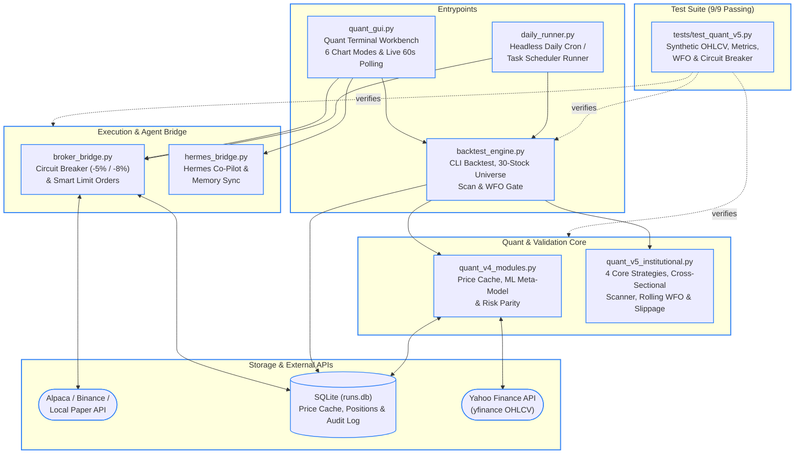

# ⚡ Quant Workbench (mini-project)

**โปรเจกนี้เป็นการลองปรับเเต่ง AI AGENT ของตัวเองเพื่อลองนำมาเทสเฉยๆ เเละใช้ AI ลงมือทำ 100% โค้ดในนี้อาจจะค่อนข้างบวมเเละมีส่วนที่ไม่จำเป็น**

**//ในส่วนของผู้จัดทำทำมีหน้าที่กำหนดไอเดียตั้งเเต่เริ่มรวมไปถึงการจัดการ UX/UI ของ dash board เอง เเละกำหนดขอบเขต(ไม่ให้เกิดฟีเจอร์หรือสิ่งที่ไม่จำเป็นมากเกินไปจนไม่สามารถใช้ได้จริง)เเละการเริ่มพัฒนา version ต่างๆ เป็นคนร่างเเผนงานเเละ prompt AI ให้ทำงานได้เส็จสิ้นตามเเผนที่ได้ว่างไว้เเต่เเรก//**

### 👤 เครดิตและบทบาทของผู้จัดทำ (Human Architect & AI Orchestrator)
โปรเจกต์นี้พัฒนาโดย **Daniel (`daniel01-bit`)** ในฐานะผู้กำกับระบบ (Human-in-the-Loop) โดยแบ่งหน้าที่ระหว่าง **มนุษย์** และ **AI Agent** ชัดเจนดังนี้:
- **กำหนดแนวคิดและเป้าหมายหลัก (Vision & System Design):** วางไอเดียตั้งต้น โจทย์การเทรดเชิงปริมาณ และสถาปัตยกรรมภาพรวมของระบบตั้งแต่ต้นจนจบ
- **ออกแบบและกำกับ UX/UI ของ Dashboard:** กำหนดเลย์เอาต์หน้าจอ สไตล์การใช้งานแบบเรียบง่าย (Minimal macOS/Terminal), โหมดกราฟเต็มจอ, เครื่องมือตีเส้นทำมือ และปรับแก้จุดบกพร่องจากประสบการณ์ใช้งานจริง
- **ควบคุมขอบเขตและตัดฟีเจอร์ส่วนเกิน (Scope Lock & Ruthless Pruning):** คัดกรองและตัดกลยุทธ์หรือฟีเจอร์ที่ไม่สร้างผลลัพธ์จริงออก (เช่น ยุบจาก 13 กลยุทธ์เหลือ 4 กลยุทธ์แกนหลัก) เพื่อไม่ให้ระบบบวมจนใช้งานจริงไม่ได้
- **วางแผน Roadmap รายเวอร์ชัน (Version & Gatekeeping):** กำหนดลำดับการพัฒนาตั้งแต่ `v1.0` จนถึง `v7.0 Final` พร้อมตั้งเกณฑ์วัดผลผ่าน (Exit Criteria) ก่อนขยับไปเฟสถัดไป
- **กำกับงานด้วย Prompt Engineering (AI Agent Orchestration):** ร่างแผนงาน แตกสเปก และสั่งการ AI Agent ให้เขียนโค้ด ทดสอบ และส่งมอบงานครบตามแผนที่วางไว้

---

ระบบวิเคราะห์หลักทรัพย์เชิงปริมาณ (Quantitative Research), คัดกรองหุ้นนำตลาดแบบ Cross-Sectional (30 หุ้นสภาพคล่องสูง), ทดสอบย้อนหลังแบบไร้ Look-ahead Bias (Dynamic Slippage + Rolling Walk-Forward Gate), เกราะตัดวงจรพอร์ตรวม (Portfolio Circuit Breaker) และระบบส่งคำสั่งอัตโนมัติแบบ Headless (`daily_runner.py`)

---

## 🏗️ 1. สถาปัตยกรรมระบบ (โครงสร้างแบบแยกโมดูล)



### 4 กลยุทธ์แกนหลักที่ผ่านการคัดกรอง (คัดลดจาก 13 → 4 กลยุทธ์หลัก)
1. **`buy_hold`**: เกณฑ์เปรียบเทียบมาตรฐาน (ซื้อแล้วถือยาว)
2. **`trend_atr_vol`**: เกาะเทรนด์ + จุดตัดขาดทุนแบบเลื่อนตาม ATR (`3.2x`) + ปรับขนาดไม้ตามความผันผวน (Volatility-Targeted Sizing)
3. **`regime_adaptive_v5`**: สลับกลยุทธ์อัตโนมัติตามสภาวะตลาด (ตลาดมีเทรนด์ → รันเทรนด์ / ตลาดไซด์เวย์ → ซื้อแนวรับขายแนวต้าน / ตลาดขาลง → ถือเงินสด 100%)
4. **`cross_sectional_mom`**: คัดเฉพาะหุ้นนำตลาดที่มีความแข็งแกร่งสัมพัทธ์สูงกว่าดัชนี (`^GSPC` / `SPY`) ควบคู่สัญญาณรายสัปดาห์ (Weekly MTF)

---

## 🛡️ 2. มาตรฐานการคุมความเสี่ยง
- **ไร้ Look-Ahead และ Selection Bias:** เลื่อนสัญญาณ 1 แท่ง (`shift(1)`), จำกัดน้ำหนักลงทุนในช่วง `[0.0, 1.0]`, คัดเลือกกลยุทธ์เฉพาะช่วง In-Sample (70% แรก) และตรวจสอบด้วย Rolling Walk-Forward (`252 วันฝึก → 63 วันทดสอบจริง`)
- **จำลองต้นทุนเทรดตามจริง:** หักค่าธรรมเนียม (`0.1%`) + Slippage แปรผันตามความผันผวนและสภาพคล่อง (`ATR/Volume` และ `5 bps` Limit Fill)
- **เกราะตัดวงจรพอร์ตรวม (Portfolio Circuit Breaker):**
  - ขาดทุนสะสมจากจุดสูงสุด (Live Drawdown) แตะ **`-5.0%`** → ลดขนาดไม้ซื้อใหม่ลง **50% (`HALF_SIZE`)** อัตโนมัติ
  - ขาดทุนสะสมแตะ **`-8.0%`** → ล็อกห้ามเปิดไม้ซื้อใหม่ (**`HALT_NEW_BUYS`**) อนุญาตให้ขายปิดสถานะเท่านั้น
- **ส่งคำสั่งแบบ Smart Limit:** ส่งคำสั่งเข้า Alpaca / Local Paper เป็น **`Limit Order`** (เผื่อระยะ `±0.2%`) แทนการเคาะ Market Order
- **เกณฑ์ก่อนลงเงินจริง (Live Capital Readiness Gate):** ติดตามประวัติ Paper Trade อัตโนมัติ โดยต้องผ่านครบ **30 ไม้ปิดสถานะ**, `Live DD > -10%` และ `Paper Return >= 0%` ก่อนเริ่มใช้เงินจริง

---

## 📊 3. ผลทดสอบจริง

**//ใช้back-test ที่เขียนขึ้นเองในการเทสระบบ เเละไม่มี look-ahead-bias //**

### 3.1 ผลทดสอบย้อนหลัง 5 ปี (ตะกร้า 30 หุ้น + สินทรัพย์หลบภัย `GLD`/`SHY`)
*(ช่วง `2022-05-31` ถึง `2026-11-20` = `1,125` วันทำการ, ผ่านตลาดหมีปี 2022, ปรับพอร์ตทุก 21 วัน, เลื่อนสัญญาณ 1 แท่ง ไร้ Look-ahead Bias)*

| ตัวชี้วัด | ผลลัพธ์จริงจาก Backtest | หมายเหตุ |
| :--- | :---: | :--- |
| **ผลตอบแทนก่อนหักค่าคอมฯ (Gross Return)** | **`+74.72%`** | ชนะดัชนี `SPY` (`+66.12%`) |
| **ผลตอบแทนสุทธิ (หลังหัก Fee `0.1%` + Slippage `5 bps`)** | **`+58.42%`** (`เฉลี่ย +10.86%/ปี`) | ต้นทุนค่าคอมฯ และ Slippage รวม `-16.30%` (บน Alpaca ค่าคอมฯ `0%` จะลดต้นทุนลงเกินครึ่ง) |
| **Profit Factor / อัตราชนะรายรอบ** | **`1.86`** / **`61.1%`** | ผ่านเกณฑ์ Profit Factor `> 1.35` |
| **Sharpe / Sortino / Max Drawdown** | `0.63` / `0.88` / `-20.41%` | รายงานตรงตามจริงผ่านระบบ Go/No-Go Gate อัตโนมัติ |

### 3.2 ผลรันชุดทดสอบอัตโนมัติ (`python -m unittest discover -s tests -p "test_*.py" -v`)
```text
test_01_indicators_integrity ... ok
test_02_dynamic_slippage_and_institutional_metrics ... ok
test_03_regime_adaptive_v5_and_four_core_strategies ... ok
test_04_explainable_ai_and_ml_meta_labeling ... ok
test_05_pre_trade_risk_gate ... ok
test_06_cross_sectional_universe_scanner_and_backtest ... ok
test_07_rolling_walk_forward_gate_zero_lookahead ... ok
test_08_circuit_breaker_and_smart_limit_order ... ok
test_09_webhook_alert_graceful_skip ... ok
----------------------------------------------------------------------
Ran 9 tests in 0.366s — OK
```

---

## 🚀 4. คู่มือติดตั้งและรันทดสอบด้วยตัวเอง

### 1) ติดตั้งแพ็กเกจที่จำเป็น (ครั้งแรกครั้งเดียว)
```powershell
pip install -r requirements.txt
```

### 2) รันชุดทดสอบอัตโนมัติทั้งหมด (`9/9 Tests`)
```powershell
python -m unittest discover -s tests -p "test_*.py" -v
```

### 3) ทดสอบสแกนตะกร้า 30 หุ้น + Cross-Sectional Backtest + ตรวจเกณฑ์ผ่าน
```powershell
python backtest_engine.py --universe-scan --period 2y --top-n 5
```

### 4) ทดสอบระบบรันรายวันอัตโนมัติ (โหมดปลอดภัย Dry-Run — ยังไม่ส่งออเดอร์)
```powershell
python daily_runner.py --dry-run
```
*(เมื่อพร้อมส่งคำสั่งเข้าพอร์ตจำลอง Local Paper หรือ Alpaca Paper ให้เปลี่ยน `--dry-run` เป็น `--execute`)*

### 5) เปิดหน้าต่าง GUI Dashboard (`v7.0 Final`)
ดับเบิลคลิก **`run_dashboard.bat`** หรือรันคำสั่ง:
```powershell
python quant_gui.py
```

### 6) ตัวอย่างตั้งเวลารันอัตโนมัติวันละครั้งบน AWS EC2 Ubuntu (Cron)
```bash
35 14 * * 1-5 cd /home/ubuntu/mini-project-quant01 && /usr/bin/python3 daily_runner.py --execute >> logs/cron.log 2>&1
```
